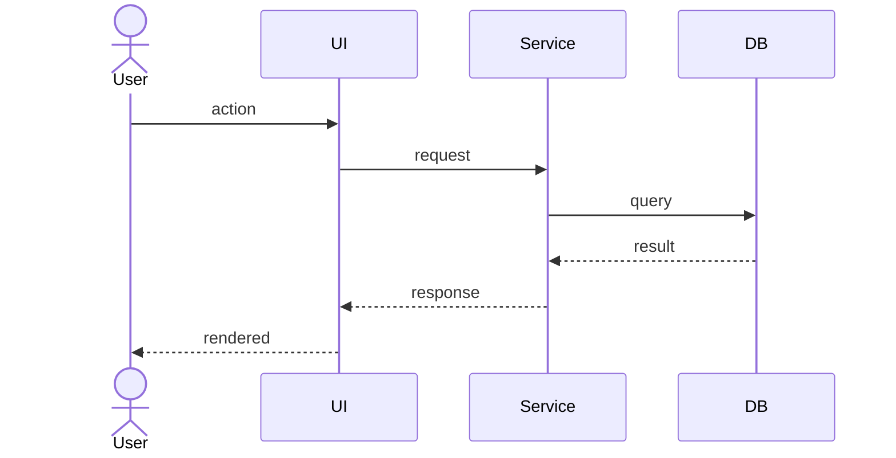

# Detail Design — {{story_key}}: {{story_title}}

| Field | Value |
|---|---|
| Story ID | {{story_id}} (epic {{epic_num}}, story {{story_num}}) |
| Story Key | {{story_key}} |
| Story File | {{story_file_relative_path}} |
| Designer | {{user_name}} |
| Design Date | {{date}} |
| Status | draft <!-- progresses: draft → self-reviewed → reviewed → approved --> |

## 1. Overview

> 3–5 sentences: what this feature does, why this design over alternatives, and the primary integration points. Must be readable as a standalone summary by someone who has not opened the story file.

## 2. Component Breakdown

> Every new or modified module, class, or function. Each entry must include signature, single-sentence responsibility, and where it lives.

| Component | Type (NEW / UPDATE) | Location | Signature / Shape | Responsibility |
|---|---|---|---|---|
|  |  |  |  |  |

## 3. Data Model & Flow

### 3.1 Schema Changes

> Tables/columns/indexes added, modified, or removed. Include type, nullability, default, and any migration notes.

### 3.2 State Transitions

> If the feature has stateful entities, list the states and the events that move between them. Use a state table or diagram.

### 3.3 Sequence — Primary Happy Path



### 3.4 Sequence — Notable Alternative / Failure Paths

> Add additional Mermaid blocks for retries, partial failures, or important branching flows. Skip only if the happy path covers everything.

## 4. API Contracts

> One subsection per endpoint or external interface. Skip the section entirely if no API surface is touched.

### 4.1 `{{METHOD}} {{path}}`

- **Purpose:**
- **Auth:**
- **Request schema:**
  ```json
  {}
  ```
- **Validation rules:**
- **Response (success):** status code + schema
  ```json
  {}
  ```
- **Response (error):** status codes, error shape, mapped to user-visible messages
- **Idempotency / retry semantics:**

## 5. File Changes

> Every file the dev will touch. Be specific — "extract X into helper Y" beats "refactor".

| Path | NEW / UPDATE | Precise change |
|---|---|---|
|  |  |  |

## 6. Edge Cases & Error Handling

> Enumerate each edge case and the chosen handling. If you cannot decide, raise it under Open Questions instead of guessing.

| # | Scenario | Handling |
|---|---|---|
| 1 |  |  |

## 7. Test Plan

> Concrete test names, mapped to acceptance criteria. The dev should be able to author these tests directly from this section.

### 7.1 Unit

- [ ] `{{TestName}}` — covers AC#__ — verifies …

### 7.2 Integration

- [ ] `{{TestName}}` — covers AC#__ — verifies …

### 7.3 End-to-End

- [ ] `{{TestName}}` — covers AC#__ — verifies …

## 8. Open Questions / Risks

> Anything you could not resolve from inputs. Better to surface than guess. Each item must have an owner and a proposed resolution path.

| # | Question / Risk | Owner | Proposed resolution |
|---|---|---|---|
| 1 |  |  |  |

## 9. Adversarial Review Findings

> Populated by the adversarial review step. If skipped, write `Skipped per configuration.`

| Severity | Finding | Disposition (addressed / accepted / deferred-to-dev) | Rationale / Link |
|---|---|---|---|

## 10. Approval Log

| Event | Who | When | Notes |
|---|---|---|---|
| Draft created | {{user_name}} | {{date}} |  |
| Self-review passed |  |  |  |
| Adversarial review |  |  |  |
| Approved |  |  |  |
