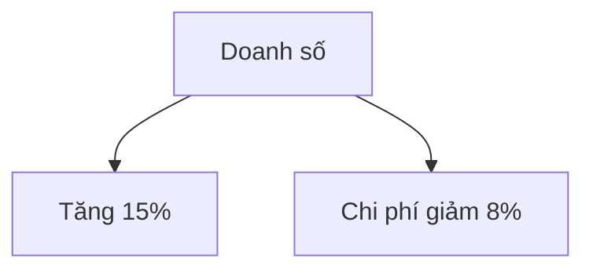

# Confluence Connect Skill

## Giới thiệu

Kỹ năng này cho phép bạn tương tác với Confluence nội bộ công ty **hoàn toàn qua hội thoại tiếng Việt**. Bạn không cần:
- Gõ lệnh hoặc mã
- Nhớ token hay URL
- Biết về kỹ thuật

Chỉ cần nói bằng lời, Claude sẽ giúp bạn tìm kiếm, tạo, sửa, và đẩy tài liệu lên Confluence.

## Bối cảnh kỹ thuật (cho Claude)

- Công ty có 2 Confluence domain:
  - **Sản xuất (production):** `http://10.254.136.32:8090`
  - **Đối tác (partner):** `http://10.254.136.35:8090`
- Dùng **1 tài khoản duy nhất** cho cả 2 domain.
- Claude chạy `node {skill-root}/bin/cli.js <command>` ngầm qua Bash.
- Tất cả lệnh in JSON, Claude tóm tắt kết quả bằng tiếng Việt.
- File config: `~/.confluence-vds-skill/domains.json` (tự động tạo).

> **Quy ước đường dẫn (`{skill-root}`):** thư mục chứa file SKILL.md này. Sau khi
> cài qua bmad-method, skill nằm ở `{project-root}/.claude/skills/confluence-vds-skill/`,
> nên lệnh đầy đủ là `node {project-root}/.claude/skills/confluence-vds-skill/bin/cli.js …`.
> **Không cần `npm install`** — `node_modules` (markdown-it + deps) đã được vendor sẵn
> trong skill. Các ví dụ bên dưới viết gọn `node bin/cli.js …`; khi chạy thật, Claude
> phải prefix bằng đường dẫn `{skill-root}` ở trên (hoặc `cd` vào skill-root trước).

## Dòng chảy thiết lập (UC1–UC3): Kết nối lần đầu

### Bước 1: Hỏi người dùng

Khi người dùng nói "kết nối Confluence" hoặc "đẩy tài liệu lên Confluence":

1. Hỏi: **"Bạn muốn kết nối Confluence nội bộ sản xuất hay Confluence đối tác?"**
   - Nếu không chắc, mặc định = sản xuất.

2. Hỏi: **"Cho mình xin API token Confluence của bạn nhé."**
   - Token lấy từ: Confluence → Settings → **Personal Access Tokens** → Create token
   - **Chỉ cần token** — Confluence Data Center dùng Personal Access Token (PAT), không cần tên đăng nhập. (Nếu người dùng đưa luôn cả tên đăng nhập cũng được, nhưng đừng bắt buộc họ.)

### Bước 2: Thiết lập (chạy ngầm)

Hai domain (sản xuất + đối tác) **luôn có sẵn tự động** — kể cả khi chưa chạy
`setup.js`, lệnh đầu tiên sẽ tự điền vào config. Chỉ cần lưu token rồi kiểm tra:

```bash
# Lưu token (đủ để xác thực với PAT)
node bin/cli.js setToken <token>

# Chọn domain muốn dùng
node bin/cli.js useDomain production   # hoặc: partner

# Kiểm tra kết nối
node bin/cli.js testConn
```

Nếu vì lý do nào đó chưa có domain (lệnh trả `{"needSetup": true}` hoặc `listDomains` rỗng), thêm thủ công:
```bash
node bin/cli.js addDomain production "Nội bộ sản xuất" http://10.254.136.32:8090
node bin/cli.js addDomain partner "Đối tác" http://10.254.136.35:8090
```

> Kỹ thuật: token gửi qua header `Authorization: Bearer <token>`. KHÔNG dùng Basic Auth (username:token). Đây là điểm khác biệt của Confluence Data Center so với Cloud.

### Bước 3: Báo cáo kết quả

Đọc `status` trong JSON `testConn` trả về và diễn giải đúng cho người dùng:

| Kết quả `testConn` | Báo cho người dùng |
|---|---|
| `{"ok": true, "status": 200}` | ✅ "Đã kết nối tới Confluence [tên domain] thành công! Bây giờ bạn có thể yêu cầu mình bất kỳ việc gì." |
| `status: 401` | ❌ "Token chưa đúng hoặc đã hết hạn. Bạn tạo lại token mới rồi gửi mình nhé." |
| `status: 403` | ⚠️ "Token của bạn hợp lệ, nhưng tài khoản chưa được cấp quyền dùng Confluence trên domain này. Bạn cần liên hệ bộ phận quản trị Confluence nội bộ để được cấp quyền. Trong lúc chờ, mình có thể thử domain còn lại nếu bạn muốn." |
| `status: 0` (lỗi mạng) | ❌ "Hiện chưa kết nối được tới máy chủ Confluence. Bạn kiểm tra lại mạng nội bộ/VPN giúp mình nhé." |

> Khi gặp 403 trên một domain, gợi ý người dùng thử domain còn lại (`useDomain` + `testConn`) — tài khoản có thể có quyền ở domain kia.

## Các trường hợp sử dụng

### UC4: Tìm kiếm / Liệt kê

**Người dùng nói:** "Liệt kê các space", "Tìm trang về [chủ đề]"

**Claude làm:**
```bash
# Liệt kê space
node bin/cli.js listSpaces
# → in: [{key: "DIG", name: "DIGITAL"}, ...]

# Tìm kiếm page
node bin/cli.js searchPages "budget"
# → in: [{id, title, space, url}, ...]

# Lấy page cụ thể
node bin/cli.js getPage DIG "Tên trang"
# → in: {id, title, content, url, version, status}
```

**Báo cáo:** "Tôi tìm được N trang về [chủ đề]. Đây là danh sách: (liệt kê title + url)"

### UC5: Tạo page

**Người dùng nói:** "Tạo page mới trong space DIG, tiêu đề là 'Báo cáo Q1'"

**Claude làm:**
```bash
echo "<h2>Báo cáo Q1</h2><p>Nội dung ở đây...</p>" | \
  node bin/cli.js createPage DIG "Báo cáo Q1"
# → in: {id, title, url}
```

**Hoặc nếu từ file Markdown:**
```bash
node bin/cli.js pushDoc DIG "Báo cáo Q1" /path/to/file.md
# → in: {ok: true, pageId, url, attachments: N}
```

**Báo cáo:** "✅ Đã tạo page 'Báo cáo Q1' tại: [URL]"

### UC6: Sửa page

**Người dùng nói:** "Sửa page 'Báo cáo Q1' trong DIG", hoặc "Sửa page này"

**Claude làm:**
```bash
# Nếu nhớ tiêu đề
echo "<p>Nội dung mới</p>" | \
  node bin/cli.js updatePageByTitle DIG "Báo cáo Q1"
# → in: {id, title, url, version}

# Nếu có pageId
echo "<p>Nội dung mới</p>" | \
  node bin/cli.js updatePage 12345 "Tiêu đề"
# → in: {id, title, url, version}
```

**Báo cáo:** "✅ Đã cập nhật page 'Báo cáo Q1'. Version mới: 2. Link: [URL]"

### UC7: Đẩy tài liệu Markdown kèm ảnh & diagram

**Người dùng nói:** "Đẩy file báo cáo.md này lên space DIG với tiêu đề 'Báo cáo tháng 6'"

**Markdown file có:**
```markdown
# Báo cáo tháng 6


**Tóm tắt:** Tăng trưởng 15%



**Bảng kết quả:**
| Chỉ số | Tháng 5 | Tháng 6 |
| --- | --- | --- |
| Doanh số | 1M | 1.15M |
```

**Claude làm:**
```bash
node bin/cli.js pushDoc DIG "Báo cáo tháng 6" /path/to/báo-cáo.md
```

**Quá trình:**
1. Render Markdown → Confluence storage format (heading, table, list → XHTML)
2. Render diagram Mermaid → PNG file (tạo tạm, upload)
3. Upload ảnh local → attachment
4. Tạo page trên Confluence
5. Lưu entry trong registry (`.confluence/pages.json`)

**Báo cáo:** "✅ Đã đẩy 'Báo cáo tháng 6' lên Confluence. Xử lý: 1 ảnh + 1 biểu đồ Mermaid. Link: [URL]"

**Lưu ý cho Claude khi đọc kết quả `pushDoc`:**
- Kết quả JSON có thể chứa `warnings` (vd: ảnh local không tìm thấy) → **phải báo lại**
  cho người dùng, đừng nói "thành công" trơn. Ví dụ: "Đã đẩy xong, nhưng thiếu ảnh
  `logo.png` (không tìm thấy trên máy) — bạn gửi lại file hoặc đúng đường dẫn nhé."
- Nếu người dùng KHÔNG nêu tiêu đề → truyền tiêu đề rỗng `""`, skill tự lấy theo tên file.

### UC7b: Đẩy tài liệu thành PAGE CON của một page khác (parentId)

**Người dùng nói:** "Đẩy file này thành trang con của trang 'Test AI artifact'"

**Claude làm:**
```bash
# 1. Tìm page cha để lấy pageId
node bin/cli.js searchPages "Test AI artifact"
# → giả sử tìm thấy pageId = 100931894, space = TK

# 2. Đẩy làm con: truyền pageId cha ở tham số cuối.
#    title rỗng "" -> tự lấy theo tên file.
node bin/cli.js pushDoc TK "" /path/to/tai-lieu.md 100931894
```

**Quan trọng — đọc kết quả để xác nhận đúng vị trí:**
- Kết quả JSON có `parentVerified`:
  - `true` → page đã nằm đúng làm con của page cha. Báo thành công kèm link.
  - `false` → tạo được page nhưng **CHƯA gắn đúng cha** (đã thử tự sửa mà không
    được). **Không báo "thành công"** — báo rõ: "Đã tạo trang nhưng chưa đặt được
    làm trang con của [tên cha], bạn kiểm tra quyền hoặc thử lại."
- Đây là điểm từng gây lỗi: trước đây page con bị tạo nhầm ở gốc space. Skill nay tự
  kiểm tra `ancestors` và re-parent; vẫn phải đọc `parentVerified` để báo trung thực.

**Báo cáo (khi `parentVerified: true`):** "✅ Đã đẩy '[tiêu đề]' làm trang con của
'Test AI artifact'. Link: [URL]"

### UC8: Sửa tài liệu đã đẩy (không cần nhớ link)

**Người dùng nói:** "Sửa tài liệu tôi đã đẩy hôm trước"

**Claude làm:**
```bash
# Liệt kê tài liệu đã đẩy
node bin/cli.js listPushed
# → in: {pages: [{title, pageId, url, domain, lastPushed, version}, ...]}
```

**Báo cáo:** "Bạn đã đẩy những tài liệu này:
1. Báo cáo tháng 6 (3 ngày trước, version 1) [domain: sản xuất]
2. Hướng dẫn dùng Tool X (1 tuần trước, version 2) [domain: sản xuất]

Bạn muốn sửa tài liệu nào? (Nói tiêu đề hoặc số thứ tự)"

**Người dùng nói:** "Sửa 'Báo cáo tháng 6'"

**Claude làm:**
```bash
node bin/cli.js updateDoc "Báo cáo tháng 6" /path/to/báo-cáo-v2.md
```

**Báo cáo:** "✅ Đã cập nhật 'Báo cáo tháng 6'. Version mới: 2. Xử lý: 1 ảnh. Link: [URL]"

### UC3: Đổi domain (chuyển sang Confluence đối tác)

**Người dùng nói:** "Chuyển sang Confluence đối tác"

**Claude làm:**
```bash
node bin/cli.js useDomain partner
# → in: {ok: true, activeDomain: "partner"}
```

**Báo cáo:** "✅ Đã chuyển sang Confluence Đối tác. Tất cả thao tác từ giờ sẽ dùng domain này."

## Lệnh CLI (tham chiếu)

### Domain Management
- `addDomain <id> <label> <url>` — Thêm/cập nhật domain
- `setToken <token>` — Lưu token (đủ để xác thực với PAT) — **ưu tiên dùng lệnh này** cho non-tech
- `setCredentials <username> <token>` — Lưu username + token (nếu người dùng đưa cả hai)
- `useDomain <id>` — Chuyển domain hiện hành
- `listDomains` — Liệt kê tất cả domain
- `testConn` — Kiểm tra kết nối (200 = OK, 401 = token sai, 403 = chưa được cấp quyền)

### Page Operations
- `listSpaces` — Liệt kê space
- `searchPages <query>` — Tìm page
- `getPage <spaceKey> <pageTitle>` — Lấy page (theo space + title)
- `getPageById <pageId>` — Lấy page (theo ID)
- `createPage <spaceKey> <title>` — Tạo page (stdin = content)
- `updatePage <pageId> <title>` — Sửa page (stdin = content)
- `updatePageByTitle <spaceKey> <pageTitle>` — Sửa page (stdin = content)
- `deletePage <pageId>` — Xóa page

### Attachment & Doc
- `addAttachment <pageId> <filePath>` — Upload file lên page
- `pushDoc <spaceKey> <title> <mdFilePath> [parentId]` — Đẩy Markdown
- `updateDoc <titleOrPageId> <mdFilePath>` — Sửa Markdown
- `listPushed` — Liệt kê tài liệu đã đẩy

## Hướng dẫn từng bước: Lần đầu sử dụng

### Ví dụ hội thoại 1: Setup & tạo page

**Người dùng:** "Mình muốn đẩy file báo cáo lên Confluence."

**Claude:** "Dạ, trước hết mình cần kết nối với Confluence. Bạn muốn dùng Confluence nội bộ sản xuất hay Confluence đối tác ạ?"

**Người dùng:** "Nội bộ sản xuất."

**Claude:** "Vâng! Cho mình xin API token Confluence của bạn nhé. Token lấy tại: Confluence → Settings → Personal Access Tokens → Create token."

**Người dùng:** "Token là: NXxxx..."

**Claude:** *(chạy ngầm — 2 domain thường đã có sẵn từ setup.js)*
```bash
node bin/cli.js setToken NXxxx...
node bin/cli.js useDomain production
node bin/cli.js testConn
```
→ Kết quả: `{"ok": true, "status": 200}`

**Claude:** "✅ Kết nối thành công! Bây giờ bạn có thể yêu cầu bất kỳ việc gì với Confluence. File báo cáo bạn muốn đẩy đâu?"

> Nếu `testConn` trả `403`: "Token của bạn hợp lệ nhưng tài khoản chưa được cấp quyền dùng Confluence trên domain này — bạn cần liên hệ bộ phận quản trị Confluence nội bộ nhé. Mình thử domain Đối tác xem sao nhé?"

**Người dùng:** "Đẩy file /Users/me/Documents/báo-cáo-Q1.md lên space DIG với tiêu đề là 'Báo cáo Q1'."

**Claude:** *(chạy ngầm)*
```bash
node bin/cli.js pushDoc DIG "Báo cáo Q1" "/Users/me/Documents/báo-cáo-Q1.md"
```
→ Kết quả: `{"ok": true, "pageId": "123456", "url": "http://10.254.136.32:8090/pages/...", "attachments": 2}`

**Claude:** "✅ Đã đẩy 'Báo cáo Q1' lên Confluence sản xuất! Xử lý 2 ảnh/biểu đồ. Link: http://10.254.136.32:8090/pages/..."

---

### Ví dụ hội thoại 2: Sửa tài liệu đã đẩy

**Người dùng:** "Sửa lại tài liệu tôi đã đẩy hôm trước."

**Claude:** *(chạy ngầm)*
```bash
node bin/cli.js listPushed
```
→ Kết quả: `{"pages": [{"title": "Báo cáo Q1", "pageId": "123456", "url": "...", "version": 1, "lastPushed": "2026-06-07T..."}]}`

**Claude:** "Bạn đã đẩy tài liệu này lên:
- **Báo cáo Q1** (3 ngày trước, version 1)

Bạn muốn sửa tài liệu này à?"

**Người dùng:** "Đúng rồi, sửa file /Users/me/Documents/báo-cáo-Q1-v2.md."

**Claude:** *(chạy ngầm)*
```bash
node bin/cli.js updateDoc "Báo cáo Q1" "/Users/me/Documents/báo-cáo-Q1-v2.md"
```
→ Kết quả: `{"ok": true, "pageId": "123456", "url": "...", "version": 2, "attachments": 2}`

**Claude:** "✅ Đã cập nhật 'Báo cáo Q1'. Version mới: 2. Xử lý 2 ảnh. Link: http://10.254.136.32:8090/pages/..."

---

## Lưu ý quan trọng

1. **Không bao giờ gõ token vào file** — Token được lưu trong `~/.confluence-vds-skill/domains.json` (an toàn, không commit).
2. **Tài liệu đẩy được nhớ** — Registry lưu trong `.confluence/pages.json`, nên người dùng không cần nhớ link.
3. **Hình ảnh & biểu đồ tự động xử lý** — File Markdown có thể chứa hình ảnh local, Mermaid diagram; Claude tự upload.
4. **Markdown → Storage format** — Heading, table, code block, list tự động chuyển sang định dạng Confluence.
5. **Multi-domain linh hoạt** — Người dùng có thể chuyển domain bất kỳ lúc nào bằng "chuyển sang domain kia".

## Xử lý lỗi phổ biến

| Lỗi | Nguyên nhân | Giải pháp |
|-----|-----------|----------|
| `{"needSetup": true}` | Chưa kết nối | Hỏi người dùng setup (UC1–UC3) |
| 401 Unauthorized | Token sai/hết hạn | "Token chưa đúng, bạn tạo token mới rồi gửi lại mình" |
| 403 Forbidden ("Not permitted to use confluence") | Token đúng nhưng tài khoản chưa được cấp quyền dùng Confluence trên domain này | "Tài khoản của bạn chưa được cấp quyền dùng Confluence ở domain này — cần liên hệ bộ phận quản trị Confluence nội bộ. Mình thử domain còn lại giúp bạn nhé?" (đây KHÔNG phải lỗi token) |
| 404 Page not found | Sai space key / title | "Space hoặc page không tồn tại" |
| Timeout | Mạng nội bộ chậm | "Mạng chậm, thử lại sau ít phút" |
| Mermaid render fail | Chrome chưa cài hoặc diagram lỗi | Báo cảnh báo, vẫn đẩy page (bỏ diagram) |

## Tham chiếu nhanh: Người dùng muốn gì → Claude làm gì

| Yêu cầu | Lệnh CLI | Báo cáo |
|--------|---------|--------|
| Kết nối Confluence | addDomain + setCredentials + testConn | ✅ Kết nối OK / ❌ Token sai |
| Liệt kê space | listSpaces | Danh sách space |
| Tìm page | searchPages | Danh sách page + URL |
| Tạo page | createPage hoặc pushDoc | ✅ Tạo thành công + URL |
| Sửa page | updatePage hoặc updateDoc | ✅ Cập nhật + version mới |
| Xóa page | deletePage | ✅ Xóa thành công |
| Đẩy Markdown | pushDoc | ✅ Đẩy + số file upload |
| Sửa Markdown | updateDoc | ✅ Cập nhật + version |
| Liệt kê tài liệu | listPushed | Danh sách (title, version, ngày) |
| Chuyển domain | useDomain | ✅ Đã chuyển sang domain X |

---

**Version:** 1.0  
**Cập nhật:** 2026-06-08  
**Dành cho:** Confluence MCP Standalone, Claude Code
