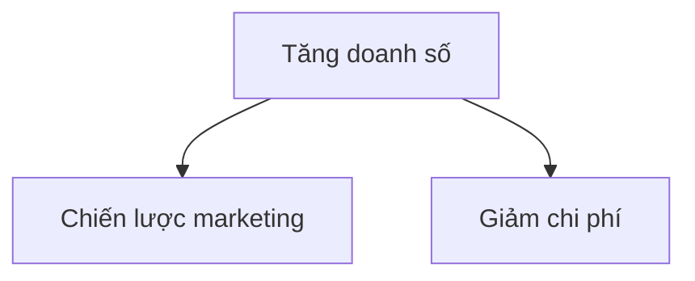

# Hướng dẫn sử dụng Confluence Connect (Tiếng Việt)

> **Cho người dùng không rành kỹ thuật.** Bạn chỉ cần nói bằng lời, Claude sẽ giúp mọi việc.

---

## Bạn có thể nói gì với mình?

### 🔗 Kết nối lần đầu

```
"Mình muốn kết nối Confluence sản xuất."
"Kết nối Confluence đối tác giúp tôi."
"Cấu hình Confluence để tôi có thể dùng được."
```

**Mình sẽ:**
1. Hỏi bạn tên đăng nhập và API token
2. Lưu vào máy (an toàn, không ai khác thấy)
3. Kiểm tra kết nối
4. Báo cáo kết quả

---

### 📋 Tìm kiếm & xem

```
"Liệt kê các space trong Confluence."
"Tìm trang về [chủ đề]." (ví dụ: "tìm trang về budget")
"Lấy nội dung trang 'Báo cáo Q1' trong space DIG."
"Xem trang này: [paste link từ Confluence]"
```

**Mình sẽ:**
- Liệt kê các space (nhóm tài liệu)
- Tìm kiếm các trang liên quan
- Lấy nội dung và hiển thị cho bạn

---

### ✏️ Tạo trang mới

```
"Tạo trang mới trong space DIG với tiêu đề 'Hướng dẫn dùng Tool X'."
"Tạo page 'Báo cáo tháng 6' trong space Kỹ thuật."
```

**Mình sẽ:**
- Tạo trang mới
- Báo cáo link để bạn xem

---

### 📝 Sửa trang hiện có

```
"Sửa trang 'Báo cáo Q1' trong DIG với nội dung mới: ..."
"Cập nhật trang này: [link]"
"Sửa tài liệu tôi đẩy hôm trước."
```

**Mình sẽ:**
- Tìm trang
- Cập nhật nội dung
- Báo cáo phiên bản mới

---

### 📄 Đẩy file Markdown (kèm ảnh & biểu đồ)

```
"Đẩy file báo-cáo.md này lên space DIG, tiêu đề 'Báo cáo Q1'."
"Đẩy /Users/tôi/Documents/hướng-dẫn.md lên space Kỹ thuật."
"Upload file này: [path/to/file.md]"
```

**File Markdown của bạn có thể chứa:**

#### ✅ Nội dung hỗ trợ
- **Heading** (# ## ### ...)
- **Đậm** (**text**)
- **Nghiêng** (*text*)
- **Danh sách** (bullet list hoặc numbered)
- **Bảng** (markdown table)
- **Link** ([text](url))
- **Code block** (```python code ```)
- **Ảnh** ( hoặc )
- **Biểu đồ** (```mermaid ... ``` — mình tự render thành hình)

#### Ví dụ file Markdown:

```markdown
# Báo cáo Quý 1

## Tóm tắt
Doanh số tăng **15%** so với quý trước.

## Số liệu chi tiết

| Chỉ số | Q4 | Q1 |
|--------|-----|-----|
| Doanh số | 1M | 1.15M |
| Chi phí | 500k | 460k |

## Sơ đồ hiển thị



## Hình ảnh


```

**Mình sẽ:**
1. ✅ Chuyển Markdown thành định dạng Confluence (đẹp)
2. ✅ Tự động upload ảnh local
3. ✅ Render biểu đồ Mermaid thành hình
4. ✅ Tạo trang trên Confluence
5. ✅ Nhớ lại (để bạn sửa lần sau không cần link)

**Báo cáo:** "✅ Đã đẩy 'Báo cáo Q1' lên Confluence. Xử lý: 1 ảnh + 1 biểu đồ. Link: [link]"

---

### 🔄 Sửa tài liệu đã đẩy (không cần nhớ link)

```
"Sửa tài liệu tôi đã đẩy hôm trước."
"Cập nhật báo cáo Q1."
"Sửa file /Users/tôi/Documents/báo-cáo-v2.md lên Confluence."
```

**Dòng chảy:**
1. Mình liệt kê các tài liệu bạn đã đẩy ("Báo cáo Q1, Hướng dẫn Tool X, ...")
2. Bạn chọn
3. Mình sửa (không cần nhớ URL hay PageID)

**Báo cáo:** "✅ Đã cập nhật 'Báo cáo Q1'. Version mới: 2. Link: [link]"

---

### 🌍 Chuyển domain (sản xuất ↔ đối tác)

```
"Chuyển sang Confluence đối tác."
"Dùng Confluence sản xuất."
"Kết nối domain khác."
```

**Mình sẽ:**
- Chuyển domain hiện hành
- Tất cả tác vụ tiếp theo dùng domain mới

---

### 🗑️ Xóa trang

```
"Xóa trang 'Báo cáo cũ' trong DIG."
"Xóa page 123456." (nếu bạn biết PageID)
```

**Mình sẽ:**
- Xóa trang
- Báo cáo kết quả

---

## Các câu hỏi thường gặp

### Q: Làm sao lấy API Token?
**A:** Vào Confluence → Cài đặt → Tài khoản → API Token → Tạo token → Copy và cho mình.

### Q: File Markdown của tôi phải lưu ở đâu?
**A:** Bất kỳ đâu trên máy tính. Chỉ cần nói đường dẫn đầy đủ: `/Users/tôi/Documents/báo-cáo.md`

### Q: Ảnh trong file Markdown phải ở định dạng gì?
**A:** Bất kỳ: PNG, JPG, GIF, ... Mình tự upload.

### Q: Nếu biểu đồ Mermaid lỗi thì sao?
**A:** Mình sẽ báo cảnh báo, nhưng vẫn đẩy trang (chỉ bỏ biểu đồ đó).

### Q: Mình có thể chỉnh sửa nội dung sau khi đẩy lên không?
**A:** Có, dùng `updateDoc` hoặc `updatePage`. Mình có thể sửa từ file Markdown mới hoặc HTML trực tiếp.

### Q: Tôi quên link trang rồi, có cách nào xem lại không?
**A:** Có! Nói: "Liệt kê tài liệu tôi đã đẩy" → mình hiển thị danh sách + link.

### Q: Có an toàn không khi cho mình username + token?
**A:** Rất an toàn. Mình lưu locally trên máy tính bạn (trong `~/.confluence-vds-skill/`), không gửi đi đâu, không hiển thị lại.

### Q: Mình có thể dùng 2 Confluence khác nhau không?
**A:** Có! Mình hỗ trợ đa domain. Chỉ cần nói "chuyển sang domain kia".

---

## Lưu ý

1. **Markdown file phải UTF-8** — Để hiển thị tiếng Việt đúng.
2. **Đường dẫn ảnh tương đối** — Nếu file.md ở `/Users/tôi/Documents/báo-cáo.md` và ảnh ở `/Users/tôi/Documents/images/logo.png`, thì trong Markdown viết: ``
3. **Tên domain** — Bạn có thể đặt tên tuỳ ý (ví dụ: "prod", "dev", "partner", ...). Mình sẽ nhớ và giúp chuyển đổi.

---

## Ví dụ cuộc hội thoại hoàn chỉnh

### Lần đầu tiên

**Bạn:** "Mình muốn đẩy file báo cáo lên Confluence sản xuất."

**Claude:** "Vâng! Trước hết, mình cần kết nối với Confluence. Bạn lấy API token từ Confluence (Cài đặt → API Token → Tạo) và cho mình."

**Bạn:** "OK, mình vừa lấy: `ghp_abc123...`. Tên đăng nhập là `truongph1`."

**Claude:** *(kết nối)* "✅ Kết nối thành công! Bây giờ bạn có thể yêu cầu bất kỳ việc gì. File báo cáo đâu?"

**Bạn:** "Đẩy file `/Users/tôi/Documents/báo-cáo-Q1.md` lên space DIG với tiêu đề 'Báo cáo Quý 1'."

**Claude:** *(xử lý)* "✅ Đã đẩy 'Báo cáo Quý 1'. Xử lý: 1 ảnh + 1 biểu đồ Mermaid. Link: http://10.254.136.32:8090/pages/viewpage.action?pageId=123456"

---

### Lần thứ hai (sửa)

**Bạn:** "Sửa báo cáo Q1 với file mới: `/Users/tôi/Documents/báo-cáo-Q1-v2.md`."

**Claude:** *(cập nhật)* "✅ Đã cập nhật 'Báo cáo Quý 1'. Version mới: 2. Xử lý: 1 ảnh. Link: http://10.254.136.32:8090/pages/viewpage.action?pageId=123456"

---

### Chuyển domain

**Bạn:** "Chuyển sang Confluence đối tác, rồi tìm trang về budget."

**Claude:** "✅ Đã chuyển sang Confluence Đối tác. Tìm kiếm... Tôi tìm được 3 trang:
1. Budget 2026
2. Budget Guidelines
3. Budget Approval Process
"

---

## Câu lệnh mẫu (không cần nhớ, chỉ tham khảo)

- "Liệt kê các space"
- "Tìm trang về [chủ đề]"
- "Tạo page mới trong [space]"
- "Sửa trang [tên] với nội dung: ..."
- "Đẩy file [path] lên [space]"
- "Liệt kê tài liệu tôi đã đẩy"
- "Sửa tài liệu [tên]"
- "Xóa trang [tên]"
- "Chuyển sang domain [tên]"

---

## Hỗ trợ

Nếu gặp vấn đề:
1. Nói cho mình biết lỗi
2. Mình sẽ giải thích và giúp khắc phục

**Ví dụ:** "Token hết hạn" → "Bạn lấy token mới và cho mình lại nhé"

---

**Version:** 1.0  
**Cập nhật:** 2026-06-08
